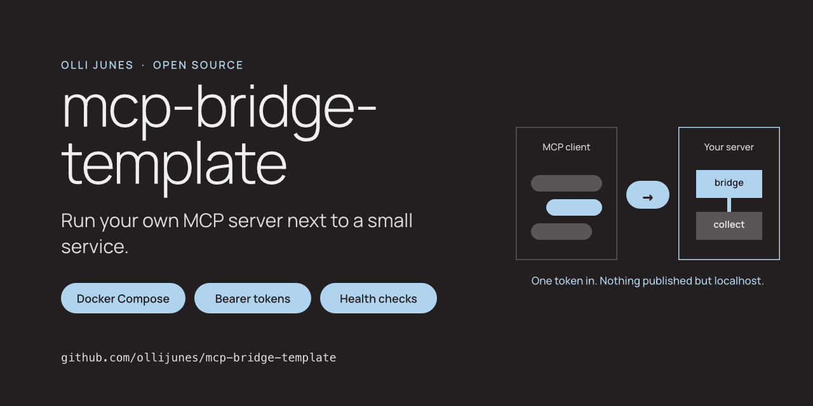
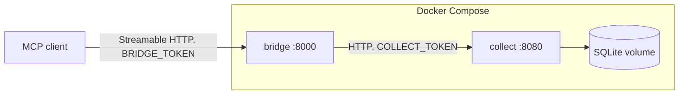

# mcp-bridge-template



[](https://github.com/ollijunes/mcp-bridge-template/actions/workflows/ci.yml)
[](pyproject.toml)
[](LICENSE)

A small, tested starting point for running your own MCP server next to a
service you already have.

[MCP](https://modelcontextprotocol.io/) lets AI clients such as Claude Code or
Codex call tools on a server you control. Most examples run the server as a
local process. This template runs it as a container with its own token, next
to a separate HTTP service, the way you would run it on a home server or a
small VPS.

It has two parts. `collect` is a tiny notes API written with the Python
standard library. `bridge` is an MCP server on the official MCP Python SDK
that turns collect's endpoints into tools. Replace collect with your own
service and keep the rest.

[Connect a client](docs/connect-a-client.md) · [Add a tool](docs/add-a-tool.md) ·
[Security](SECURITY.md) · [Contributing](CONTRIBUTING.md) ·
[ollijunes.com](https://ollijunes.com)

Read the story behind it: [in English](https://ollijunes.com/mcp-bridge-template-docker-compose/) · [suomeksi](https://ollijunes.com/fi/oma-mcp-palvelin-docker/).



## What you get

- Two services in Docker Compose. Collect has no published port. The bridge
  listens on `127.0.0.1:8000` only.
- Two bearer tokens from the environment: one for MCP clients, one between
  the bridge and collect. Both services refuse to start without them.
- Health endpoints and Compose health checks. The bridge waits for collect to
  be healthy before it starts.
- Hardened containers: non-root user, read-only filesystem, no capabilities,
  base image pinned by digest.
- Tests for both services, including an MCP client talking to the bridge, and
  a Compose smoke test in CI.

## Quick start

You need Docker with Compose and, for development, Python 3.11+ and
[uv](https://docs.astral.sh/uv/).

```sh
git clone https://github.com/ollijunes/mcp-bridge-template.git
cd mcp-bridge-template
cp .env.example .env
```

Create two random tokens and put them in `.env` in place of the placeholders:

```sh
python3 -c "import secrets; print(secrets.token_urlsafe(32))"
```

`.env` is in `.gitignore`. Keep it out of commits and backups you share.

Start the services:

```sh
docker compose up -d --build --wait
curl http://127.0.0.1:8000/healthz
```

```json
{"status": "ok"}
```

A request to `/mcp` without the token is refused:

```sh
curl -i -X POST http://127.0.0.1:8000/mcp
```

```text
HTTP/1.1 401 Unauthorized
```

Then [connect a client](docs/connect-a-client.md). With Codex CLI, for
example:

```sh
export BRIDGE_TOKEN=...   # the value from .env
codex mcp add notes --url http://127.0.0.1:8000/mcp --bearer-token-env-var BRIDGE_TOKEN
```

Ask the client to add a note and list your notes. Stop everything with
`docker compose down`; add `-v` to delete the notes volume too.

## Tools

| Tool | What it does |
| --- | --- |
| `add_note(text, tags)` | Stores a note of up to 2,000 characters with up to 10 tags |
| `list_notes(limit, tag)` | Lists the newest notes, optionally by tag |
| `collect_health()` | Reports whether collect is reachable |

They are examples. [Add a tool](docs/add-a-tool.md) shows how to add your own
and what to think about before you give one to a model.

## Configuration

Set these in `.env`:

| Variable | Used by | Default |
| --- | --- | --- |
| `BRIDGE_TOKEN` | bridge | required, at least 32 characters |
| `COLLECT_TOKEN` | bridge, collect | required, at least 32 characters |
| `BRIDGE_PORT` | Compose | `8000`, always bound to `127.0.0.1` |
| `BRIDGE_ALLOWED_HOSTS` | bridge | empty: loopback only. Comma-separated hostnames, for example `bridge.example.com`, when a proxy or VPN name is used. The list replaces the loopback default, so add `127.0.0.1:*` if you also connect locally |
| `BRIDGE_ALLOWED_ORIGINS` | bridge | empty: loopback only. Comma-separated origins, for example `https://bridge.example.com` |

Compose sets two more variables itself. Change them only when you run the
services without Compose:

| Variable | Used by | Value in Compose |
| --- | --- | --- |
| `COLLECT_URL` | bridge | `http://collect:8080` |
| `COLLECT_DB_PATH` | collect | `/data/notes.sqlite3`, on the `notes` volume |

## Limitations

- No TLS. To reach the bridge from another machine, put a reverse proxy with
  TLS in front of it or use a private network, and list the hostname in
  `BRIDGE_ALLOWED_HOSTS` and `BRIDGE_ALLOWED_ORIGINS`. Do not bind it to
  `0.0.0.0` without one.
- One shared token, no user accounts, scopes or rate limits. Fine for one
  person and their own clients; not for a team.
- The bridge is stateless and answers with JSON, not server-sent events. This
  keeps it simple; long-running tools that stream progress need a change.
- Collect's notes are an example. Do not store secrets in them.

## Development

```sh
uv sync --locked
uv run python -m pytest --cov=collect --cov=bridge --cov-fail-under=85
uv run ruff check .
uv run ruff format --check .
python3 scripts/check_public_tree.py
```

The tests start both services in-process with synthetic tokens, so they do
not need Docker or a real token. CI also builds the images, starts them
with Compose and runs [scripts/smoke_test.sh](scripts/smoke_test.sh).

## License

[MIT](LICENSE). Made by [Olli Junes](https://ollijunes.com). Not affiliated with
Anthropic, OpenAI or the Model Context Protocol project.
